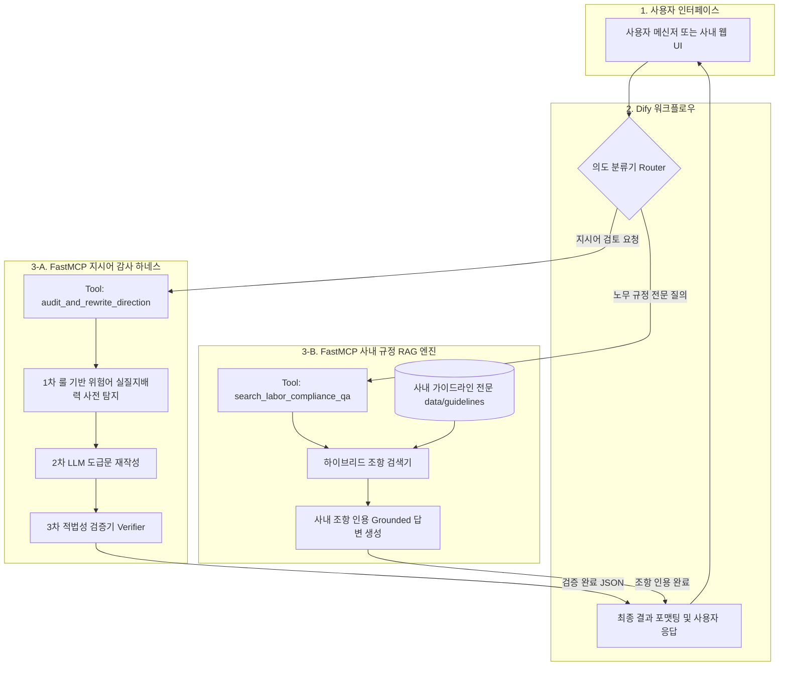

# Safe-Guard Agent (FastMCP Server)

원하청 적법 도급(Compliance) 관리를 위한 실시간 업무 지시 가이드 및 노무 Q&A 에이전트의 MCP 서버입니다.  
사내 폐쇄망 환경에서 **Dify 오케스트레이터의 Custom Tool**로 연동되어 구동됩니다 (상세 워크플로우 캔버스 설정: [Dify 구축 가이드](appendix/DIFY_WORKFLOW_GUIDE.md)).

---

## 1. 주요 기능 및 제공 Tool

### 🛠️ Tool 1: `audit_and_rewrite_direction`

- **목적**: 원청 실무자의 업무 지시문에서 불법 파견 요건 및 노란봉투법상 원청 사용자성 인정 요건을 정밀 필터링하고 적법한 도급 요청문으로 변환 제안.
- **주요 반환 항목**:
  - `risk_level`: `SAFE`(안전) / `CAUTION`(주의) / `DANGER`(위험)
  - `risk_score`: 위험도 점수 (0 ~ 100)
  - `violations`: 위반 법적 요건 (실질적 지배력, 직접 지휘명령, 특정인 지정, 근태/시간 강제 등)
  - `flagged_phrases`: 원문 내 문제 어휘 목록
  - `legal_basis`: 노조법 제2조 제2호, 대법원 판례(2015다211624, CJ대한통운 2023누35795 등) 및 법령 근거
  - `yellow_envelope_analysis`: 노란봉투법 전용 정밀 분석 (실질적 지배력 감지, 사용자성 인정 리스크, 단체교섭 요구 위험 분석)
  - `rewrites`: 협력사 현장대리인(소장) 경유의 적법 도급 변환문 목록
  - `verification_passed`: Post-Guardrail 하네스 검증기 통과 여부

### 📚 Tool 2: `search_labor_compliance_qa`

- **목적**: `data/guidelines/` 사내 도급 가이드라인 전문 및 판례집을 **RAG(Retrieval-Augmented Generation)**로 실시간 검색하여, 사내 규정 조항(제O조)을 인용하는 전문 법무/노무 가이드 제공.
- **주요 반환 항목**:
  - `compliance_status`: 허용(적법) / 원칙적 불가(위법 소지) / 조건부 허용
  - `summary_answer`: 핵심 가이드 요약
  - `legal_basis`: 인용된 사내 규정 조항(예: 제10조 복리후생, 제9조 장비대여 등) 및 판례 근거
  - `do_and_dont`: 현장 실무자를 위한 구체적 DO & DON'T 행동 지침
  - `recommended_action`: 현장 실무자 즉시 조치 사항
  - `references`: 인용된 사내 문서 및 판례 출처

---

## 2. 사내 지식 베이스 (`data/guidelines/`) 구조 및 교체 방법

`data/guidelines/` 폴더에 마크다운(`.md`) 또는 텍스트(`.txt`) 문서를 넣어두면, RAG 엔진이 서버 기동 시 자동으로 조항 단위로 청킹하여 검색합니다:

```text
data/guidelines/
├── 01_subcontract_guidelines.md   # 사내 도급 운영 컴플라이언스 가이드라인 (제1조 ~ 제25조 전면 개정 전문)
├── 02_labor_ministry_qa.md        # 고용노동부 사내하도급 실무 판단기준 및 빈출 Q&A (식대, OJT, 명절선물, 클린룸 등 Q1~Q20)
└── 03_court_precedents.md         # 대법원 및 법원 주요 불법파견/노란봉투법 핵심 판례 15선 요약집 (현대차, 포스코, 삼성전자서비스 등)
```

> **💡 사내 실제 문서로 교체하는 방법**:  
> 사내 법무/노무팀에서 제공한 실제 보안 가이드라인 문서나 매뉴얼이 있는 경우, 해당 텍스트를 위 파일명에 그대로 덮어쓰거나 새로운 `.md` 파일을 추가하기만 하면 코드 수정 없이 즉시 사내 데이터로 검색됩니다.

---

## 3. 하네스 & RAG 아키텍처



---

## 4. 통합 테스트 실행 방법

모든 기능 검증(고위험 지시어, 노란봉투법, 그레이존 5대 판별, RAG Q&A)은 **단 하나의 통합 테스트 스크립트**로 일괄 수행할 수 있습니다:

```bash
# 통합 테스트 실행 (All-in-One)
python tests/test_suite.py
```

- **검증 항목**:
  1. **고위험 지시어 & 노란봉투법**: 특정인 직접 지시 및 안전보건 제재 징표 탐지
  2. **회색지대(Gray Zone) 판별력**: 청유형 위장 지시(위험) vs 정당한 하자보수(합법) 분별
  3. **사내 규정 RAG Q&A**: 식당 식대 지원, SOP 열람 등 사내 규정 제O조 인용 확인
  4. **최신 법원 판례 및 산안법 긴급권 정밀 판별**: 산업안전보건법 긴급대피(SAFE 0점 인정), 포스코 판례(단톡방 지시 적발), 현대차 판례(MES 전산지시 적발), 원하청 혼재작업 적발, 현장대리인 공식소통 적법성 유지

---

## 5. FastMCP 서버 구동 (Dify 연동 대기)

```bash
# 기본 포트(80) 구동
python src/main.py

# 로컬 테스트 시 포트 변경 구동
$env:PORT=8000; python src/main.py
```

---

## 6. 환경 변수 설정 (`.env`)

- `LLM_PROVIDER`: `gemini` (테스트 단계) 또는 `internal` (사내 폐쇄망 배포 단계)
- `GEMINI_API_KEY`: 테스트 단계 Google Gemini API 키
- `LLM_BASE_URL`: 사내 OpenAI 호환 API 엔드포인트 URL (기본: `http://localhost:8000/v1`)
- `LLM_MODEL_NAME`: 사내 서빙 모델명 (예: `GLM-5.3-Flash`, `npo-maxis-llm` 등)

---

## 7. 기술 백서 및 부록 (Appendix)

시스템의 하네스 엔지니어링 아키텍처, 무결성 안전장치 및 Dify 실전 구축 가이드는 아래 부록 문서에서 확인하실 수 있습니다:

- 📖 **[하네스 엔지니어링 아키텍처 및 안전장치 백서](appendix/HARNESS_ARCHITECTURE_AND_SAFETY.md)**
  1. 질문 인입부터 최종 답변 도출까지 전체 라이프사이클 (E2E Mermaid 다이어그램)
  2. 왜 이것이 '하네스 엔지니어링(Harness Engineering)'인가? (나이브 LLM vs 하네스 비교)
  3. 엉뚱한 답변을 원천 차단하는 5중 무결성 방어벽
  4. [심층 분석 1] 제5방어벽 Fallback 엔진의 답변이 100% 신뢰 가능한 이유 (전문가 규칙 시스템)
  5. [심층 분석 2] RAG 검색 결과가 엉뚱한 조항을 물어오지 않는다고 확신하는 이유 (도메인 부스팅 및 Bounding)
  6. 경연대회 심사위원 및 사내 보고용 핵심 엘리베이터 피치
- 🛠️ **[Dify 워크플로우 구축 실전 가이드](appendix/DIFY_WORKFLOW_GUIDE.md)**
  1. Dify 커스텀 도구(FastMCP) 등록 절차
  2. 5개 노드(Start, Router, Tool, Formatter, Answer) 프롬프트 및 설정 전문
  3. 사내 LLM 호출 상태 실시간 모니터링 (`llm_invoked`, `execution_mode`)


