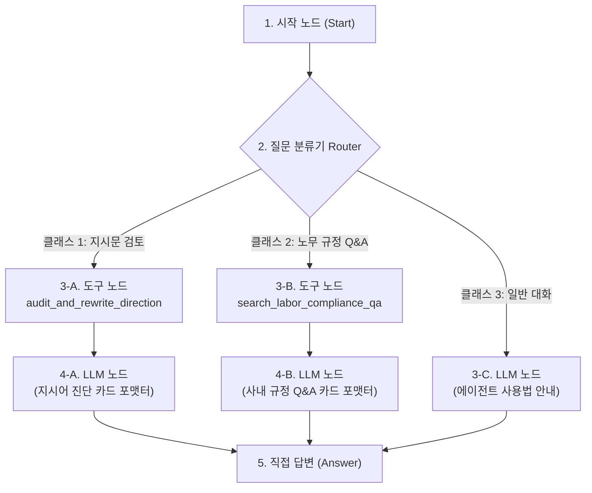

# Safe-Guard Agent: Dify 워크플로우 구축 가이드 (최신 현행화 버전)

본 문서는 사내 Dify 환경에서 **Safe-Guard FastMCP 서버를 연동하여 완전한 대화형 에이전트(Chatflow)**를 구축하기 위한 실전 가이드입니다.  
Dify 웹 캔버스를 띄워두고 아래 노드 설정과 프롬프트를 **그대로 복사·붙여넣기**하여 즉시 운영하실 수 있습니다.

---

## 1. 사전 준비: Dify에 FastMCP 커스텀 도구(Tool) 등록

Dify 캔버스 작업 전에, 사내망에 배포된 FastMCP 서버를 Dify 도구로 먼저 등록해야 합니다.

1. Dify 좌측 메뉴 ➜ **[도구 (Tools)]** ➜ **[커스텀 도구 추가 (Create Custom Tool)]** 클릭
2. **기본 정보 입력**:
   * **도구 이름**: `safe_guard_agent`
   * **전송 방식**: HTTP
   * **엔드포인트 URL**: `http://<사내_서버_IP>:80/` (배포된 FastMCP 주소)
3. 등록 완료 시 아래 2개 도구가 정상 노출되는지 확인합니다:
   * `audit_and_rewrite_direction`: 지시문 적법성 진단 및 소장 경유문 변환 (산안법 긴급대피 인정 포함)
   * `search_labor_compliance_qa`: 사내 규정(제1조~제25조) 및 판례(15선) RAG 기반 노무 질의응답

---

## 2. 워크플로우 아키텍처 (Chatflow)

Dify 메인 ➜ **[앱 만들기]** ➜ **[처음부터 만들기]** ➜ 유형: **[Chatflow (대화형 워크플로우)]** 선택.



---

## 3. 노드별 상세 설정 및 프롬프트 전문 (복사해서 사용)

### 📍 [노드 1] 시작 노드 (Start)
* 기본값 유지 (`sys.query` 변수 사용)
* *(선택 사항)* 세션 변수에 `department`(부서명), `subcontractor`(협력사명)를 추가하여 `context_info`로 전달 가능.

---

### 📍 [노드 2] 질문 분류기 (Question Classifier)
* **모델 선택**: 사내 LLM (GLM-5.3-Flash, NPO-MAXIS 등)
* **클래스 설정**:

#### [클래스 1] `direction_audit`
* **설명 (Description)**:
  ```text
  원청 실무자가 협력사 직원에게 보낼 업무 지시 텍스트를 검토하거나, 이렇게 말해도 되는지 적법성을 점검해달라는 발화.
  ```
* **예시 발화 (Few-Shot)**:
  - *"김 대리한테 3라인 센서 교체하라고 메신저 보내도 돼?"*
  - *"내일 14시까지 작업 무조건 끝내놓으라고 하려고 해"*
  - *"협력사 작업자들 안전모 안 쓰면 다음 주부터 출입 금지시킨다고 통보할게"*
  - *"혹시 오늘 야근 좀 해달라고 부탁해도 괜찮나?"*
  - *"협력사 기사님들 카톡 단톡방에 작업 사진 바로 올려달라고 공지할게"*
  - *"3라인 협력사 작업자분들 MES 화면 보고 순서 바꿔서 진행하세요"*
  - *"가스 누출 비상벨 울렸으니 즉시 작업 중지하고 대피하세요"*
  - *"협력사 박 기사, 오늘 우리 부서 A직원 옆에서 보조 작업 같이 진행해"*

#### [클래스 2] `labor_qa`
* **설명 (Description)**:
  ```text
  도급 계약 규정, 파견법, 노란봉투법, 복리후생, 식대, 근태, OJT 교육, 명절선물, 클린룸, 장비 PM 등 사내 노무 규정에 대해 단순 문의하는 질문.
  ```
* **예시 발화 (Few-Shot)**:
  - *"협력사 직원에게 사내 식당 식대 지원해주면 불법파견인가요?"*
  - *"원청 작업표준서(SOP)를 협력사 직원에게 보여줘도 되나요?"*
  - *"협력사 신규 입사자에게 원청 직원이 직접 1:1 OJT 교육을 시켜줘도 되나요?"*
  - *"설 명절에 햄 선물세트나 온누리상품권을 협력사 직원에게 직접 나눠줘도 되나요?"*
  - *"설비 비상 알람(Interlock)이 울렸을 때 원청 엔지니어가 리셋 스위치를 조작해도 되나요?"*
  - *"클린룸 방진복이나 정전기화를 협력사에 무상으로 대여해줘도 되나요?"*
  - *"작업 중 부상당한 협력사 직원을 사내 의무실에서 치료하고 공상 처리해도 되나요?"*
  - *"협력사 직원의 출퇴근 관리를 위해 사내 출입증 지문 기록을 열람해도 되나요?"*

#### [클래스 3] `general`
* **설명 (Description)**:
  ```text
  단순 인사, 챗봇 사용법 안내, 감사 표현 등 일상 대화.
  ```
* **예시 발화 (Few-Shot)**:
  - *"안녕"*, *"너는 무슨 일 해?"*, *"도움말 보여줘"*

---

### 📍 [노드 3-A] 도구 노드 (지시어 감사)
* **도구 선택**: `safe_guard_agent ➜ audit_and_rewrite_direction`
* **입력 파라미터 매핑**:
  * `instruction_text`: `{{#sys.query#}}`
  * `context_info`: `""` (또는 `{{#sys.department#}}`)

---

### 📍 [노드 3-B] 도구 노드 (노무 Q&A)
* **도구 선택**: `safe_guard_agent ➜ search_labor_compliance_qa`
* **입력 파라미터 매핑**:
  * `question`: `{{#sys.query#}}`

---

### 📍 [노드 4-A] LLM 노드 (지시어 진단 결과 포맷터)
MCP Tool이 반환한 JSON을 사용자 메신저용 고품질 마크다운 카드로 변환합니다.

* **모델 선택**: 사내 모델 (GLM-5.3-Flash 등)
* **SYSTEM 프롬프트**:
  ````text
  당신은 사내 적법 도급 및 노란봉투법 컴플라이언스 비서 'Safe-Guard Agent'입니다.
  Tool이 정밀 진단한 JSON 데이터를 읽고, 현장 실무자가 한눈에 이해하고 바로 복사하여 사용할 수 있도록 아래 [출력 양식]에 맞추어 명쾌한 마크다운으로 작성하세요.

  [출력 양식]
  ### 🛡️ 지시어 컴플라이언스 진단 결과
  - **진단 엔진 상태**: {execution_mode가 'HARNESS_EMERGENCY_PROTECTION'이면 '🚨 산안법 긴급피난 적법 모드', llm_invoked가 'Y'면 '⚡ 사내 LLM 지능 추론', else '🛡️ 하네스 룰 엔진 Fallback (안전모드)'}
  - **위험도 판정**: {risk_level이 DANGER면 '🔴 고위험 (불법파견/노란봉투법 위반 소지)', CAUTION이면 '🟡 주의 (오해 소지)', SAFE면 '🟢 안전 (적법한 도급 요청)'} (위험 점수: {risk_score}점 / 100점)
  - **진단 요약**: {summary}
  - **적발된 위험 문구**: {flagged_phrases 목록}

  > ⚖️ **노란봉투법 & 법적 근거**
  > - {legal_basis}
  > - **원청 사용자성 인정 리스크**: {yellow_envelope_analysis.employer_status_risk}
  > - **단체교섭 주의점**: {yellow_envelope_analysis.collective_bargaining_risk}

  ---

  ### ✨ 추천 적법 도급문 (클릭하여 복사 후 전송하세요)
  {각 rewrite 항목별로 아래 박스 생성}
  > 📋 **전달 채널**: {rewrites.channel}
  ```text
  {rewrites.rewritten_text}
  ```
  - **수정 포인트**: {rewrites.key_points 목록}

  ---

  ### 💡 현장 실무자 행동 지침 (Do & Don't)
  - {action_guides 목록을 불릿 포인트로 작성}
  ````
* **USER 프롬프트**:
  ```text
  [원문 지시어]
  {{#sys.query#}}

  [Tool 분석 데이터 (JSON)]
  {{#Tool_Audit.text#}}
  ```

---

### 📍 [노드 4-B] LLM 노드 (노무 Q&A 포맷터)
* **SYSTEM 프롬프트**:
  ```text
  당신은 사내 도급 운영 가이드라인(제1조~제25조) 및 판례(15선) 전문 노무 AI 어드바이저입니다.
  Tool이 RAG 지식 베이스에서 검색하여 분석한 JSON 데이터를 바탕으로, 현장 실무자가 사내 규정을 준수할 수 있도록 명확하게 답변하세요.

  [출력 양식]
  ### 📚 사내 도급/노무 규정 가이드
  - **진단 엔진 상태**: {llm_invoked가 'Y'면 '⚡ 사내 LLM 지능 추론' else '🛡️ 하네스 RAG Fallback (안전모드)'}
  - **적법 판정**: **{compliance_status}**
  - **핵심 답변**: {summary_answer}

  > 📖 **인용된 사내 규정 및 판례 조항**
  > - {legal_basis}
  > - **참조 문서**: {references 목록}

  ---

  ### 📋 현장 실무 수칙 (DO & DON'T)
  {do_and_dont 항목들을 DO와 DONT로 깔끔하게 구분하여 나열}

  ---

  ### 🚀 권장 조치 사항
  - **{recommended_action}**
  ```
* **USER 프롬프트**:
  ```text
  [실무자 질문]
  {{#sys.query#}}

  [RAG 분석 데이터 (JSON)]
  {{#Tool_QA.text#}}
  ```

---

### 📍 [노드 4-C] LLM 노드 (일반 대화 및 사용법 안내)
* **SYSTEM 프롬프트**:
  ```text
  당신은 원하청 적법 도급(Compliance) 및 노란봉투법 리스크 관리를 위한 실시간 업무 지시 가이드 비서 'Safe-Guard Agent'입니다.
  친절하고 정중한 어조로 사용자를 맞이하고, 에이전트의 2가지 주요 기능과 사용법을 안내하세요.

  [안내 내용]
  1. 📝 **업무 지시문 적법성 검토**: 협력사에 메신저나 유선으로 전달하려는 지시문을 입력하시면, 불법파견 및 노란봉투법 위반 소지를 분석하고 소장님 경유 적법문으로 바꿔드립니다.
  2. 📚 **사내 도급/노무 규정 Q&A**: 식대 지원, OJT 교육, 명절 선물, 장비 알람, SOP 열람, 장비 대여, 잔업, 근태 관리 등 현장에서 발생하는 도급 경계 질문에 대해 사내 가이드라인(제1조~제25조)을 근거로 가이드해 드립니다.
  ```
* **USER 프롬프트**:
  ```text
  {{#sys.query#}}
  ```

---

### 📍 [노드 5] 직접 답변 노드 (Answer)
각 브랜치의 LLM 출력 변수를 지정합니다:
```text
{{#LLM_Audit_Format.text#}}
{{#LLM_QA_Format.text#}}
{{#LLM_General.text#}}
```

---

## 4. 사내 폐쇄망 LLM 미연결 시 동작 원리 (하네스 Fallback 엔진)

FastMCP 서버 내부에는 **사내 LLM 엔드포인트가 연결되지 않았거나 네트워크 장애가 발생해도 시스템이 멈추지 않는 지능형 Fallback 엔진**이 내장되어 있습니다.

```text
[Dify ➜ FastMCP Tool 호출]
       │
       ▼
[1] Pre-Guardrail (Python Regex) ──► 인명, 명령형, 안전제재, MES, 단톡방 0.001초 탐지
       │
       ▼
[2] 사내 LLM 호출 시도 ──────────► (만약 localhost:8000 미연결 / 실패 시?)
       │
       ├──► (실패 감지)
       ▼
[3] Harness Fallback Engine 가동  ──► Pre-Guardrail 탐지 키워드 + 사내 66개 조항
       │                             규정을 조합하여 완벽한 컴플라이언스 JSON 자동 생성!
       ▼
[4] Verifier 검증 및 Dify 정상 반환 ──► Dify에서는 100% 정상 결과 수신!
```

* 따라서 **사내 LLM 서버가 아직 세팅되지 않은 상태에서도 Dify 워크플로우는 100% 정상 작동하며 고품질 진단 결과를 출력**합니다.
* 사내 LLM(NPO-MAXIS / GLM-5.3-Flash)이 준비되면 `.env`의 URL과 토큰만 입력해주시면 자연어 생성 품질이 한 단계 더 업그레이드됩니다.

---

## 5. 사내 LLM 호출 상태 실시간 모니터링 (`llm_invoked` & `execution_mode`)

Dify 운영 중 FastMCP 내부에서 어떤 모드가 구동되었는지 투명하게 추적할 수 있도록 2개의 상태 필드를 제공합니다:

* **`llm_invoked`** (`str`):
  * `"Y"`: 사내 LLM(또는 테스트 모델)이 성공적으로 응답하여 지능형 추론을 완료함.
  * `"N"`: 사내 LLM 미연결, 타임아웃, 파싱 오류로 인하여 하네스 룰/RAG Fallback 엔진이 구동됨.
* **`execution_mode`** (`str`):
  * `"INTERNAL_LLM"`: LLM 기반 자연어 생성 모드
  * `"HARNESS_FALLBACK"`: 규칙 및 사내 가이드라인 기반 무장애 안전 모드
  * `"HARNESS_EMERGENCY_PROTECTION"`: 산업안전보건법 제51조/제52조에 의거한 긴급 대피/작업중지 정당성 보호 모드

### 💡 Dify에서의 활용 방법:
1. **Dify 조건 분기(IF/ELSE) 노드**:
   * `{{#Tool_Audit.llm_invoked#}} == "Y"` 조건으로 분기하여 사내 LLM 작동 통계를 집계하거나 알림을 전송할 수 있습니다.
2. **사용자 화면 표기**:
   * 최종 마크다운 카드 상단에 `[진단 엔진: ⚡ 사내 LLM 지능 추론]` 또는 `[진단 엔진: 🛡️ 하네스 룰 엔진]` 뱃지를 표시하여 시스템 동작 상태를 투명하게 체감할 수 있습니다.
